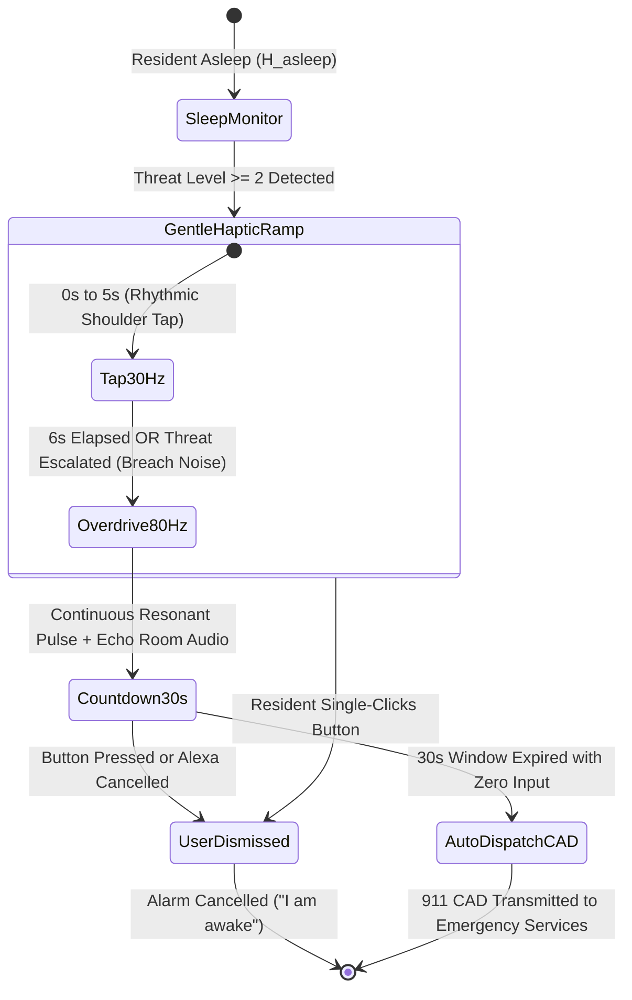

# Project Vigil+: Master UI/UX Specification & Wireframe Blueprint

> **Specification Reference:** [`docs/UI_UX_DESIGN_DECISIONS.md`](UI_UX_DESIGN_DECISIONS.md) • [`docs/SYSTEM_DESIGN.md`](SYSTEM_DESIGN.md)  
> **Target Audience:** Autonomous Coding Agents (Kiro, KiroCrew) & Frontend Engineers  
> **Standard:** Spec-Driven Development (SDD) — Zero Placeholder Boilerplate, Zero Ambiguity  
> **Status:** Final Architectural Blueprint  

---

## 1. Design System Foundation & Design Tokens

Vigil+ implements an **Architectural Ambient** design system. It eschews generic SaaS purple gradients, bubbly cards, and low-contrast text in favor of an authoritative, high-contrast residential aesthetic inspired by Bang & Olufsen, Teenage Engineering, and Linear.

### 1.1 Color Palette & Chroma Calibration

```
┌────────────────────────────────────────────────────────────────────────┐
│                        VIGIL+ CHROMATIC TOKENS                         │
├───────────────────┬─────────────┬──────────────────────────────────────┤
│ Token Name        │ Hex Code    │ Functional Role                      │
├───────────────────┼─────────────┼──────────────────────────────────────┤
│ `bg-obsidian`     │ `#090A0B`   │ Root application canvas & deep void  │
│ `surface-volcano` │ `#141618`   │ Primary card background & panels     │
│ `surface-elevated`│ `#1E2124`   │ Popovers, modals, elevated toasts    │
│ `border-subtle`   │ `#2B3035`   │ 1px structural hair-lines            │
│ `border-focus`    │ `#4A525A`   │ Interactive focus states & TV rings  │
│ `text-primary`    │ `#F2F4F7`   │ 100% white bone typography (headers) │
│ `text-muted`      │ `#9AA2AB`   │ High-legibility body & telemetry text│
│ `text-dim`        │ `#636B74`   │ Secondary timestamps & units         │
│ `accent-amber`    │ `#F59E0B`   │ Alert tripwire & active perimeter LED│
│ `accent-cyan`     │ `#06B6D4`   │ Nominal telemetry & hardware health  │
│ `accent-crimson`  │ `#EF4444`   │ Level 3 emergency dispatch indicator │
│ `accent-emerald`  │ `#10B981`   │ Verified whitelist & perimeter secure│
└───────────────────┴─────────────┴──────────────────────────────────────┘
```

### 1.2 Typography Hierarchy
All type utilizes high-contrast optical sizing with tabular numeric alignment for timestamps and signal values.
* **Font Family (Display & UI):** `Geist Sans`, `Inter`, or system `-apple-system, BlinkMacSystemFont`.
* **Font Family (Telemetry & Values):** `Geist Mono` or `JetBrains Mono` with `font-feature-settings: "tnum" 1`.
* **Scale:**
  * `text-hero`: $32\text{px} / 1.1$ (Sanctuary headline, 600 weight)
  * `text-title`: $20\text{px} / 1.25$ (Section headers & modal titles, 600 weight)
  * `text-body`: $15\text{px} / 1.5$ (Guidance copy & event notes, 400 weight)
  * `text-label`: $12\text{px} / 1.2$ (Uppercase category badges, 600 weight, letter-spacing $+0.05\text{em}$)
  * `text-mono-sm`: $13\text{px} / 1.4$ (Timestamps, sensor confidence, coordinates)

### 1.3 Spacing & Border Radii
* **Grid:** 8pt baseline grid (`space-1`: 4px, `space-2`: 8px, `space-3`: 12px, `space-4`: 16px, `space-6`: 24px, `space-8`: 32px).
* **Corner Radii:** Strict architectural curvature:
  * Panels/Cards: `rounded-xl` ($12\text{px}$)
  * Buttons/Pills: `rounded-lg` ($8\text{px}$)
  * Status Capsules: `rounded-full` (Pill shape)
* **Shadows:** Minimal, hardware-like elevation:
  * `elevation-card`: `0 1px 2px rgba(0,0,0,0.4), 0 0 0 1px #2B3035`
  * `elevation-modal`: `0 12px 32px rgba(0,0,0,0.7), 0 0 0 1px #4A525A`

---

## 2. Screen 1: Mission Control (Desktop & Tablet)

The primary interface for the resident (Dr. Maya Lin) when reviewing home security on an iPad or laptop.

### 2.1 Wireframe Layout (Nominal Ambient State)

```
┌──────────────────────────────────────────────────────────────────────────────────────────────────┐
│  VIGIL+   [PRIMARY RESIDENCE]                                         [MAYA LIN (ADMIN)] [● SYS] │
├──────────────────────────────────────────────────────────────────────────────────────────────────┤
│                                                                                                  │
│   ┌──────────────────────────────────────────────────────────────────────────────────────────┐   │
│   │                                 SANCTUARY STATE CAPSULE                                  │   │
│   │                                                                                          │   │
│   │                  ●  PERIMETER SECURE — ALL GROUNDS NOMINAL                               │   │
│   │               "Front Entrance Monitored • External Perimeter Quiet"                      │   │
│   │                                                                                          │   │
│   │   [● Front Door: Active]   [● Night Sentry: Armed]   [● Household: 3/3 on Premises]      │   │
│   └──────────────────────────────────────────────────────────────────────────────────────────┘   │
│                                                                                                  │
│   ┌──────────────────────────────────────────────┐  ┌────────────────────────────────────────┐   │
│   │ LIVE PERIMETER EYE (RING WEBRTC)             │  │ HARDWARE MESH TELEMETRY                │   │
│   ├──────────────────────────────────────────────┤  ├────────────────────────────────────────┤   │
│   │ [STREAM: FRONT PORCH CAM - 1080P]            │  │ • RING PRO 2                           │   │
│   │                                              │  │   Battery: Mains AC  | Wi-Fi: -48dBm   │   │
│   │                                              │  │   Sensor Health: Φ_M=1.0 Φ_V=1.0 Φ_A=1.0│  │
│   │                                              │  │                                        │   │
│   │                                              │  │ • BEE WEARABLE (MAYA)                  │   │
│   │                                              │  │   State: Asleep (Quiet >3h) | Clip     │   │
│   │                                              │  │   Alert: Whisper/Nightstand Armed      │   │
│   │                                              │  │                                        │   │
│   │                                              │  │ • FIRE TV (LIVING ROOM)                │   │
│   │                                              │  │   State: Standby (HDMI-CEC Ready)      │   │
│   │                                              │  │   Deterrence Engine: Bundled AAC Ready │   │
│   │                                              │  │                                        │   │
│   │  [TALK VIA INTERCOM]     [EXPAND STREAM]     │  │ • ECHO BEDROOM (ALEXA+)                │   │
│   │                                              │  │   Voice Mode: Low-Freq Whisper Ready   │   │
│   └──────────────────────────────────────────────┘  └────────────────────────────────────────┘   │
│                                                                                                  │
│   ┌──────────────────────────────────────────────────────────────────────────────────────────┐   │
│   │ PERIMETER ACTIVITY DIGEST (EXTERNAL BOUNDARY ONLY)                                       │   │
│   ├──────────────┬───────────────────────────────┬─────────────────────────────┬─────────────┤   │
│   │ Timestamp    │ Event Description             │ Classification              │ Action Taken│   │
│   ├──────────────┼───────────────────────────────┼─────────────────────────────┼─────────────┤   │
│   │ 23:15:14 UTC │ Parcel delivery at porch      │ Level 1: Safe Courier (12s) │ Logged (Mute│   │
│   │ 22:45:00 UTC │ Curfew Mode auto-engaged      │ System State Transition     │ Armed Sentry│   │
│   │ 18:30:22 UTC │ Front door accessed           │ Verified Household (Jordan) │ Zero-Trace  │   │
│   └──────────────┴───────────────────────────────┴─────────────────────────────┴─────────────┘   │
└──────────────────────────────────────────────────────────────────────────────────────────────────┘
```

### 2.2 Wireframe Layout (Active Level 2 Threat State)
When a masked prowler manipulates the lock at night, the screen does **not** flash red. It transforms into the **"Active Protector" Guidance Mode**:

```
┌──────────────────────────────────────────────────────────────────────────────────────────────────┐
│  VIGIL+   [● ACTIVE DEFENSE RUNNING]                                  [ALERT: FRONT DOORWAY]     │
├──────────────────────────────────────────────────────────────────────────────────────────────────┤
│                                                                                                  │
│   ┌──────────────────────────────────────────────────────────────────────────────────────────┐   │
│   │ ▲ PERIMETER ALERT — ACTIVE PROTECTION IN PROGRESS                                        │   │
│   │                                                                                          │   │
│   │ "Unknown individual manipulating front entryway. Perimeter alert active.                 │   │
│   │  Fire TV living room deterrence is blasting simulated occupancy.                        │   │
│   │  Emergency CAD manifest is staged. Please remain inside."                                │   │
│   │                                                                                          │   │
│   │ [DO NOT OPEN DOOR]    [SPEAK THROUGH INTERCOM]    [CANCEL ALARM (FALSE)]   [DISPATCH 911]│   │
│   └──────────────────────────────────────────────────────────────────────────────────────────┘   │
│                                                                                                  │
│   ┌──────────────────────────────────────────────┐  ┌────────────────────────────────────────┐   │
│   │ LIVE BREACH STREAM                           │  │ THREAT ATTRIBUTION (AWS BEDROCK)      │   │
│   ├──────────────────────────────────────────────┤  ├────────────────────────────────────────┤   │
│   │ [STREAM: SUSPECT AT DOORWAY WITH PRY TOOL]   │  │ Threat Score: 0.88 / 1.0 (Level 2)     │   │
│   │ Bounding Box: Masked Human (Conf: 0.94)      │  │ Visual: Hooded subject, crowbar        │   │
│   │ Audio FFT: Lock scraping detected (3.2 kHz)  │  │ Audio: Metal-on-metal prying           │   │
│   │                                              │  │ Resident: Maya asleep (Echo whispered) │   │
│   │ Dwell Timer: 22s (Exceeded 15s Threshold)    │  │ Deterrent: Fire TV Dog/Voices (75% vol)│   │
│   └──────────────────────────────────────────────┘  └────────────────────────────────────────┘   │
└──────────────────────────────────────────────────────────────────────────────────────────────────┘
```

---

## 3. Screen 2: Smartphone Pocket Mission Control & Lock-Screen UX

The smartphone provides on-the-go awareness when away, and contained nightstand awareness when asleep.

### 3.1 Lock-Screen Contained Critical Alert Card (Nightstand Mode)
* **Behavior:** Screen wakes up smoothly to 50% brightness. Sound is a low-frequency rising hum ($40\text{Hz} - 80\text{Hz}$) bypassing Do Not Disturb via Apple Critical Alerts.
```
┌────────────────────────────────────────┐
│  03:14 AM                              │
│  Tuesday, October 24                   │
│                                        │
│  ┌──────────────────────────────────┐  │
│  │ 🛡️ VIGIL+ • CRITICAL ALERT        │  │
│  │ Front Door Perimeter Active      │  │
│  │                                  │  │
│  │ Unknown individual at door.      │  │
│  │ Perimeter alert. Deterrence on.  │  │
│  │ Stay inside your room.           │  │
│  │                                  │  │
│  │ [VIEW LIVE STREAM]   [DISMISS]   │  │
│  └──────────────────────────────────┘  │
│                                        │
│         [Slide up to unlock]           │
└────────────────────────────────────────┘
```

### 3.2 Mobile Dashboard (One-Thumb Ergonomics)
* Top Capsule: Circular Sanctuary Ring (Green = Secured, Amber = Loitering, Red = Active Breach).
* Mid Section: 16:9 Ring WebRTC video player with rounded corners.
* Bottom Sheet: Quick actions: `[Intercom Talk]` (Hold to speak), `[Night Sentry Toggle]`, `[Emergency 1-Tap SOS]`.

---

## 4. Screen 3: 10-Foot Living Room Display (Fire TV / Vega OS)

### 4.1 State 1: Heads-Up System PIP (Watching Media + Courier Arrival)
When the resident is watching a movie and a delivery driver walks up, the movie **continues playing without audio drop**. A sleek, semi-transparent toast slides in:

```
┌──────────────────────────────────────────────────────────────────────────────────────────────────┐
│                                                                                                  │
│   [ MOVIE PLAYING FULL SCREEN - "THE RINGS OF POWER" ]                                           │
│                                                                                                  │
│                                                        ┌─────────────────────────────────────┐   │
│                                                        │ 🛡️ FRONT PORCH                      │   │
│                                                        │ [LIVE VIDEO: COURIER WITH BOX]      │   │
│                                                        │ "Delivery courier on porch (8s)"    │   │
│                                                        │ [OK / Press Center for Intercom]    │   │
│                                                        └─────────────────────────────────────┘   │
│                                                                                                  │
│                                                                                                  │
└──────────────────────────────────────────────────────────────────────────────────────────────────┘
```

### 4.2 State 2: Full-Screen Threat Takeover (Hostile Intruder Breach)
If an active prowler is detected while watching TV, media automatically pauses, and the screen takes over:
```
┌──────────────────────────────────────────────────────────────────────────────────────────────────┐
│                                                                                                  │
│   ┌──────────────────────────────────────────────────────────────────────────────────────────┐   │
│   │ 🛡️ VIGIL+ DEFENSE ACTIVE • LIVING ROOM SECURE                                           │   │
│   │ "Front door monitored. Active deterrence running. CAD staged. Stay inside."              │   │
│   └──────────────────────────────────────────────────────────────────────────────────────────┘   │
│                                                                                                  │
│   ┌──────────────────────────────────────────────────────────────────────────────────────────┐   │
│   │                                                                                          │   │
│   │                         [ FULL-SCREEN LIVE RING WEBRTC FEED ]                            │   │
│   │                         Subject: Masked Prowler at Front Porch                           │   │
│   │                         Deterrent Audio: "Home Alone" Dialogue & Barking Active          │   │
│   │                                                                                          │   │
│   └──────────────────────────────────────────────────────────────────────────────────────────┘   │
│                                                                                                  │
│   [Press BACK to resume movie]          [Press OK to Speak Intercom]       [Press RED to SOS]    │
└──────────────────────────────────────────────────────────────────────────────────────────────────┘
```

---

## 5. Screen 4: Bee Wearable Interface & Haptic Engine

### 5.1 Tier A: Screenless Bee Pioneer Hardware Button Engine
Since the physical Bee device has zero display, its interaction language is strictly tactile and mechanical:



* **Physical Button Semantics:**
  * **Single Click:** *"I am awake / Cancel false alarm."* Immediately terminates haptics and aborts 30s CAD countdown.
  * **Long Press ($>3\text{s}$):** *"Silent Duress Emergency Trigger."* Transmits instant silent 911 dispatch.
  * **LED Blink Pattern:** Green = Disarmed/Safe, Flashing Amber = Overdrive Wake, Solid Crimson = Emergency Staged.

### 5.2 Tier B: Apple Watch (Running Bee Software) OLED Micro-Card
For users wearing an Apple Watch running Bee, the OLED screen wakes to this exact high-contrast micro-card:

```
┌────────────────────────┐
│  03:14                 │
│  ┌──────────────────┐  │
│  │ 🛡️ L2 FRONT DOOR │  │
│  │ PROWLER DETECTED │  │
│  │ TV Deterrent On  │  │
│  └──────────────────┘  │
│                        │
│  [ DISMISS ]           │
│  [ CONFIRM 911 ]       │
└────────────────────────┘
```
* **Dismiss Button:** Dark gray background (`#2B3035`), bone text.
* **Confirm 911 Button:** Dark crimson background (`#7F1D1D`), white text.

---

## 6. Voice & Acoustic Architecture (Alexa+ & Ring Intercom)

### 6.1 Alexa+ Interior Bedroom Whisper Protocol
Triggered automatically on the bedroom Echo Dot when Night Sentry mode is engaged:

```xml
<speak>
  <amazon:effect name="whispered">
    <prosody pitch="-15%" rate="92%">
      Maya. Someone is on the front porch. Stay inside and stay quiet.
      Living room deterrence has been triggered. Stay in your room.
    </prosody>
  </amazon:effect>
</speak>
```

### 6.2 Ring Exterior Doorbell Intercom Scripts
Executed over the outdoor Ring speaker based on our hierarchical Day/Night logic:

* **Scenario A (Daytime Indeterminate Visitor): Firm Synthetic Sentry**
  > *"Notice: The resident is unavailable. This area is under digital observation. Deliveries may be placed on the porch."*
* **Scenario B (Nighttime Indeterminate Loiterer $>15\text{s}$): Deceptive Ambient Bluff**
  > *"Hold on a second, coming to the door right now!"*  
  > *(Followed immediately by local asset playback: heavy footsteps on wood + deep dog bark).*
* **Scenario C (Active Violent Breach / Tool Detected): Authoritative Evidentiary Warning**
  > *"Perimeter breach detected. Authorities notified. Emergency dispatch active."*

---

## 7. Anti-Slop & Un-Vibe Code Standards

To guarantee that Kiro and frontend agents build a clean, production-grade interface, this specification enforces the following bans:

1. **Banned: Generic Circular Radial Gauges.** No decorative SVG circular dials with fake percentages. Use linear, monospace tabular bars (`Confidence: 0.88 [████████░░]`).
2. **Banned: Purple Gradients & Neon Glow Bloat.** The UI must remain strictly in volcanic charcoal (`#141618`), white bone (`#F2F4F7`), and functional amber (`#F59E0B`).
3. **Banned: Horizontal Page Scrolling.** All screens must fit strictly within their viewport with zero lateral scrollbars (`overflow-x: hidden`).
4. **Banned: Placeholder Mock Strings.** No `"Lorem ipsum"`, `"John Doe"`, or `"User 123"`. All scenarios use concrete persona fixtures (`Dr. Maya Lin`, `Jordan Lin`, `Courier (Amazon Logistics)`).
5. **Banned: Unformatted Epoch Timestamps.** Timestamps must always be rendered in human-readable UTC or local 12-hour format (`03:14:22 UTC` or `3:14 AM`).
6. **Banned: Missing Error & Offline States.** Every screen must provide an explicit, styled Degraded Mode state (e.g. *"Front Camera Degraded ($\Phi_V=0.0$) — Triangulating Audio & PIR"*).

---

## 8. Frontend Component Tree Architecture

For implementation in React/Vite (or Next.js/React Native TV):

```
src/web/
├── components/
│   ├── sanctuary/
│   │   ├── SanctuaryCapsule.tsx        # Hero status indicator
│   │   └── PerimeterBoundaryBadge.tsx  # Optical perimeter boundary confirmation
│   ├── streams/
│   │   ├── RingVideoPlayer.tsx     # WebRTC/HLS live feed with PIP toggle
│   │   └── ThreatBoundingBox.tsx   # Overlay bounding box for vision telemetry
│   ├── telemetry/
│   │   ├── HardwareMeshStatus.tsx  # Health of Ring, Bee, TV, Echo (Φ meters)
│   │   └── ActivityDigestTable.tsx # External boundary activity river
│   ├── crisis/
│   │   ├── ActiveProtectorCard.tsx # Guidance card for Level 2/3 events
│   │   └── CadDispatchModal.tsx    # 911 CAD manifest confirmation modal
│   └── tv/
│       ├── TvHeadsUpToast.tsx      # Fire TV non-intrusive system notification
│       └── TvSentryTakeover.tsx    # Fire TV full-screen threat takeover
└── tokens/
    ├── colors.ts                   # Chromatic tokens
    └── typography.ts               # Type scale and font rules
```
