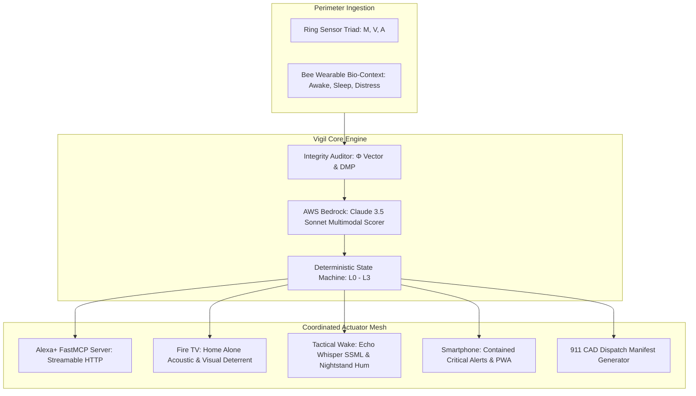

# Amazon Vigil: Phased Implementation Roadmap & Tasks

> **Target Workspace:** `C:\Mridul\Programs\Vigil`  
> **Master Specifications:**  
> • [`SPEC.md`](SPEC.md) — Mathematical formulations & state machine logic  
> • [`docs/SYSTEM_DESIGN.md`](docs/SYSTEM_DESIGN.md) — Features, operational modes & personas  
> • [`docs/UI_UX_SPECIFICATION.md`](docs/UI_UX_SPECIFICATION.md) — Design tokens, component wireframes & anti-slop rules  
> • [`docs/UI_UX_DESIGN_DECISIONS.md`](docs/UI_UX_DESIGN_DECISIONS.md) — Locked design rationale (DR-01 to DR-06)  
> **Methodology:** Spec-Driven Development (SDD) via Kiro Pro (Claude 3.5 Sonnet)  
> **Status:** Architecture & Specifications Frozen. Ready for Execution.  

---

## Architecture Flow

---

## Phase 1: Environment & Repository Scaffolding
- [ ] **Task 1.1: Project Root Setup**
  - Initialize directory structure: `src/core`, `src/adapters`, `src/simulator`, `src/web`, `tests`, `docs`.
  - Create `pyproject.toml` with `uv` support targeting Python 3.11+.
  - Dependencies: `mcp>=1.0.0`, `boto3>=1.34.0`, `pydantic>=2.0.0`, `pytest>=8.0.0`, `fastapi>=0.110.0`, `uvicorn>=0.28.0`, `pillow>=10.0.0`.
- [ ] **Task 1.2: Open Source Licensing**
  - Verify `LICENSE` (MIT License) with full attribution for the **Open Source Challenge**.
- [ ] **Task 1.3: Core Type Definitions & Pydantic Schemas**
  - Define `SensorIntegrityVector` ($\Phi_M, \Phi_V, \Phi_A, \Phi_{\text{net}} \in [0.0, 1.0]$).
  - Define `PerimeterTelemetry` ($M, V, A, \Phi$, timestamp, raw payloads).
  - Define `SubjectClassification` and `HostState`.
  - Define `ThreatAssessment` and `MeshActionPlan`.

---

## Phase 2: Sensor Integrity Auditor & Degraded Mode Protocol (DMP)
- [ ] **Task 2.1: Integrity Auditor Implementation (`src/core/integrity_auditor.py`)**
  - Implement $\vec{\Phi}$ calculation based on variance, SNR, frame saturation, and sensor health flags.
- [ ] **Task 2.2: Optical Failure Handlers (A1 - A4)**
  - Implement Lens Tamper detection ($\Phi_V=0.0 \to$ Acoustic-Motion Triangulation fallback).
  - Implement Laser/IR wash detection ($\Phi_V=0.0 \to$ Tampering alert).
  - Implement Masking detection ($\Phi_V=0.5 \to$ Pose-heuristic dwell timer).
  - Implement 2D spoofing liveness rejection.
- [ ] **Task 2.3: Acoustic Failure Handlers (B1 - B3)**
  - Implement Acoustic Jamming suppression ($\Phi_A=0.0 \to$ Optical-dominant fallback).
  - Implement Whisper/Sub-vocal zoom ($\Phi_A=0.5 \to$ High-band spectral filter).
  - Implement Voice Replay / Deepfake challenge-response trigger.
- [ ] **Task 2.4: Motion & Biometric Failure Handlers (C1 - D3)**
  - Implement PIR crawl optical flow watchdog.
  - Implement PIR flapping cooldown filter.
  - Implement Bee Off-Wrist conservative fail-safe (defaults to $H_{\text{asleep}}$, routes wake alert to bedroom Echo whispered SSML and phone Nightstand Alert).
  - Implement Unresponsive Host actuator escalation ($+6\text{dB}$ deterrent volume).

---

## Phase 3: Threat Scorer & Deterministic State Machine
- [ ] **Task 3.1: Deterministic State Machine (`src/core/state_machine.py`)**
  - Implement strictly bounded states: `L0_SAFE`, `L1_AMBIGUOUS`, `L2_SUSPICIOUS`, `L3_CRITICAL`.
  - Implement the 4 operational modes: Daytime Ambient, Night Sentry, Vacation/Away, Silent Duress.
  - Enforce zero unverified 911 dispatches: Level 3 requires multi-sensor corroboration or active distress flag.
- [ ] **Task 3.2: Edge Rule Engine (Local Fallback)**
  - Implement zero-latency local rule table when AWS Bedrock is unreachable or times out ($>1500\text{ms}$).
- [ ] **Task 3.3: Emergency CAD Dispatch Generator (`src/core/cad_dispatcher.py`)**
  - Format structured 911 Computer-Aided Dispatch payload: incident ID, timestamps, GPS, photographic stills, audio transcripts, threat severity breakdown.

---

## Phase 4: Hardware Adapters & Simulators
- [ ] **Task 4.1: Ring Adapter & VideoProcessor Plugin (`src/adapters/ring_adapter.py`)**
  - Implement mock/live connector for Ring motion events, WebRTC video stream, and SSE webhooks using `references/ring-api-helloworld`.
  - Implement client-side `VideoProcessor` plugin interface detecting lens tamper / spray paint ($\Phi_V=0.0$) and WebRTC audio uplink for porch bluff speech.
- [ ] **Task 4.2: Bee Bio-Grounding Adapter (`src/adapters/bee_adapter.py`)**
  - Implement wrapper around `bee-cli` (`bee now --json`, `bee today --context`) to extract conversation recency timestamps and stillness to infer sleep state ($H_{\text{asleep}}$ vs $H_{\text{awake}}$).
  - Implement Dual-Tier Hardware UX Contract (Screenless Bee Pioneer clip vs Apple Watch).
- [ ] **Task 4.3: Fire TV Deterrent Launcher (`src/adapters/firetv_adapter.py`)**
  - Implement headless background daemon and WebSocket bridge to Fire TV player using `references/react-native-multi-tv-app-sample`.
  - Package local bundled audio assets (`dialogue_murmur.aac`, `dog_bark_alert.aac`, `footsteps.aac`) for offline deterrence.
  - Implement HDMI-CEC power-on command and decibel ramp curve.
- [ ] **Task 4.4: Alexa / Echo Speaker & Boot-Bridge (`src/adapters/alexa_adapter.py`)**
  - Implement bedroom low-frequency whispered SSML synthesizer.
  - Implement hallway **Echo Boot-Bridge** emitting low-latency 150ms footsteps while Fire TV wakes over HDMI-CEC.

---

## Phase 5: FastMCP Streamable HTTP Server (Alexa+ Core)
- [ ] **Task 5.1: FastMCP Server Initialization (`src/server.py`)**
  - Configure FastMCP server with Streamable HTTP transport (MCP Spec 2025-11-25+).
- [ ] **Task 5.2: Tool Registration**
  - Expose `audit_perimeter_event`, `query_wearer_state`, `trigger_tactical_wake`, `trigger_firetv_deterrence`, `format_emergency_cad_packet`, `disarm_perimeter_alert`, `explain_incident_reasoning`, `set_mesh_guard_profile`.
- [ ] **Task 5.3: End-to-End MCP Verification**
  - Verify MCP Inspector connectivity and tool invocation with JSON payloads.

---

## Phase 6: Amazon Bedrock Multimodal Threat Reasoner
- [ ] **Task 6.1: Bedrock Client Integration (`src/adapters/bedrock_analyzer.py`)**
  - Integrate AWS SDK `boto3` Bedrock runtime calling `anthropic.claude-3-5-sonnet-20241022`.
- [ ] **Task 6.2: Structured Output Enforcement**
  - Enforce strict Pydantic JSON schema extraction for `ThreatAssessment`.
- [ ] **Task 6.3: Multi-Modal Fusion Prompt**
  - Feed Ring image base64 + audio transcript + host state into Bedrock for cognitive threat scoring.

---

## Phase 7: UI/UX Multi-Screen Implementation (Spec: `docs/UI_UX_SPECIFICATION.md`)
- [ ] **Task 7.1: Web Console Setup (`src/web/`)**
  - Initialize React + Vite + Tailwind CSS workspace matching the Architectural Ambient tokens (`#090A0B`, `#141618`, `#F2F4F7`, `#F59E0B`).
- [ ] **Task 7.2: Sanctuary Capsule & Telemetry Panels**
  - Implement `SanctuaryCapsule` (Perimeter status, optical boundary confirmation via `PerimeterBoundaryBadge`, resident presence count).
  - Implement `HardwareMeshStatus` displaying real-time $\vec{\Phi}$ sensor health gauges.
- [ ] **Task 7.3: Active Protector Guidance Cards & Modal**
  - Implement `ActiveProtectorCard` rendering calm, step-by-step guidance during Level 2/3 events.
  - Implement `CadDispatchModal` showing cryptographic CAD evidentiary manifest.
- [ ] **Task 7.4: Fire TV Heads-Up Overlay & Fullscreen HUD**
  - Build non-intrusive top-right PIP system toast and fullscreen camera takeover matching `docs/UI_UX_SPECIFICATION.md` §4.
- [ ] **Task 7.5: Mobile Responsive PWA & Critical Alert Card**
  - Build lock-screen Contained Critical Alert card and one-thumb mobile dashboard matching `docs/UI_UX_SPECIFICATION.md` §3.

---

## Phase 8: Deterministic Scenario Simulator & Test Suite
- [ ] **Task 8.1: Scenario Definitions (`src/simulator/canned_scenarios.json`)**
  - Encode all 10 Baseline Scenarios and 14 Degraded Mode test vectors.
- [ ] **Task 8.2: Baseline Test Suite (`tests/test_scenarios_baseline.py`)**
  - Automated tests asserting exact state machine transitions for Scenarios 01 through 10.
- [ ] **Task 8.3: Resilience Test Suite (`tests/test_resilience_matrix.py`)**
  - Automated tests asserting correct degraded-mode adaptations for Failures A1 through E2.

---

## Phase 9: Contest Deliverables & Friction Logs
- [ ] **Task 9.1: AWS Builder Documentation (`docs/AWS_INTEGRATION.md`)**
  - Document runtime Bedrock integration + Kiro Pro development role for the **AWS Builder Mini Challenge**.
- [ ] **Task 9.2: Developer Friction Log (`docs/FRICTION_LOG.md`)**
  - Compile structured friction logs (task, expected, actual, severity, workaround, Amazon recommendation) claiming the **10% judging bonus**.
- [ ] **Task 9.3: Demo Video Script & Storyboard**
  - Prepare a 2.5-minute demo video script covering: (1) The Problem, (2) The 4-Device Architecture, (3) Live Scenario Demos, (4) Sensor Tamper Resilience.
- [ ] **Task 9.4: Devpost Submission Dossier & Tagged Release `v1.0.0`**
  - Prepare Devpost written narrative (Inspiration, Architecture, Challenges, Accomplishments).
  - Create tagged release `v1.0.0` on `main` branch with MIT License and zero secrets.
